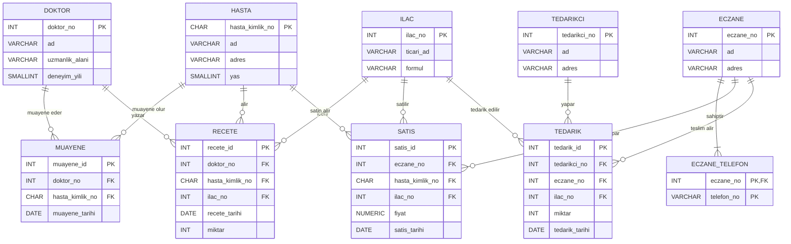

# 💊 Eczane Veritabanı Yönetim Sistemi

Veri Tabanı Yönetim Sistemleri dersi proje ödevi (Senaryo 5 – Eczane).
Hasta, doktor, muayene, ilaç, reçete, eczane, satış ve tedarik süreçlerini **PostgreSQL** veritabanında modelleyen ve **Flask** web arayüzüyle yöneten bir uygulama.

| | |
|---|---|
| 📄 Rapor | `docs/rapor/eczane_vtys_rapor.pdf` *(eklenecek)* |
| 📊 Sunum | `docs/sunum/eczane_vtys_sunum.pdf` *(eklenecek)* |
| 🗺️ ER diyagramı | `docs/er/eczane_er.png` *(eklenecek)* |
| 🗄️ Tek parça kurulum SQL'i | `docs/teslim/tam_kurulum.sql` *(eklenecek)* |
| 🤝 Katkı kuralları | [CONTRIBUTING.md](CONTRIBUTING.md) |

---

## Ekip

| Ad Soyad | Öğrenci No | Modül | Tablolar |
|---|---|---|---|
| Rojin Topuz | 032390078 | M1 – Hasta & Muayene | `hasta`, `muayene` |
| Meltem Can | 032490033 | M2 – Doktor & Reçete | `doktor`, `recete` |
| Elifnur Özkaya | 032390036 | M3 – Eczane & Satış | `eczane`, `eczane_telefon`, `satis` |
| Altyn Baktybekova | 032390093 | M4 – İlaç & Tedarik | `ilac`, `tedarikci`, `tedarik`, `tedarik_denetim` |

---

## Senaryo

Her hastanın benzersiz bir kimlik numarası, adı, adresi ve yaşı vardır. Her doktorun benzersiz bir numarası, adı, uzmanlık alanı ve mesleki deneyim süresi bulunur. Doktorlar hastaları muayene eder ve her muayenenin tarihi kaydedilir. Her ilacın benzersiz bir numarası, ticari adı ve formülü vardır. Doktorlar hastalara ilaç reçete eder; her reçete için tarih ve miktar kaydedilir. Her eczanenin benzersiz bir numarası, adı, adresi ve birden fazla telefon numarası vardır. Eczaneler hastalara ilaç satar; her satış için fiyat ve tarih saklanır. İlaç tedarikçilerinin benzersiz bir numarası, adı ve adresi vardır ve eczanelere ilaç tedarik ederler. Her tedarik işlemi için ilaç miktarı ve tedarik tarihi kaydedilir.

### Varsayımlar

1. **Yaş**, senaryoya uygun olarak saklanan bir nitelik olarak tutulur (`yas`).
2. **Reçete, Satış ve Tedarik** üçlü (ternary) ilişkilerdir. İlişkisel modelde her biri yapay anahtarlı (`_id`) ayrı bir tablodur; doğal tekrar `UNIQUE` kısıtıyla engellenir.
3. Satışta miktar bilgisi olmadığından **her satış kaydı 1 kutu** kabul edilir.
4. Eczane telefonu çok değerli bir nitelik olduğundan 1NF gereği ayrı tabloya (`eczane_telefon`) taşınmıştır.
5. Bir ilacın satılabilmesi için satış tarihinden önce o hastaya reçete edilmiş olması, bir reçetenin yazılabilmesi için de doktorun hastayı daha önce muayene etmiş olması gerekir. Bu iş kuralları trigger ile uygulanır.

---

## ER diyagramı

ER diyagramı **Chen gösterimiyle** çizilmiştir (dikdörtgen: varlık, elips: nitelik, eşkenar dörtgen: ilişki).

> `docs/er/eczane_er.png` eklendiğinde burada görünecek.

---

## İlişkisel şema

PK **kalın**, FK *italik*.

| Tablo | Kolonlar |
|---|---|
| `hasta` | **hasta_kimlik_no**, ad, adres, yas |
| `doktor` | **doktor_no**, ad, uzmanlik_alani, deneyim_yili |
| `ilac` | **ilac_no**, ticari_ad, formul |
| `eczane` | **eczane_no**, ad, adres |
| `eczane_telefon` | ***eczane_no***, **telefon_no** |
| `tedarikci` | **tedarikci_no**, ad, adres |
| `muayene` | **muayene_id**, *doktor_no*, *hasta_kimlik_no*, muayene_tarihi |
| `recete` | **recete_id**, *doktor_no*, *hasta_kimlik_no*, *ilac_no*, recete_tarihi, miktar |
| `satis` | **satis_id**, *eczane_no*, *hasta_kimlik_no*, *ilac_no*, fiyat, satis_tarihi |
| `tedarik` | **tedarik_id**, *tedarikci_no*, *eczane_no*, *ilac_no*, miktar, tedarik_tarihi |
| `tedarik_denetim` | **denetim_id**, tedarik_id, islem_turu, eski_miktar, yeni_miktar, islem_zamani |



### Veri tipleri ve kısıtlar

| Alan türü | Tip | Kısıt |
|---|---|---|
| Kimlik no | `CHAR(11)` | `CHECK (... ~ '^[1-9][0-9]{10}$')` |
| Varlık numarası (`_no`) | `INTEGER GENERATED BY DEFAULT AS IDENTITY` | PK |
| İlişki tablosu anahtarı (`_id`) | `INTEGER GENERATED BY DEFAULT AS IDENTITY` | PK |
| Ad, ticari ad, uzmanlık | `VARCHAR(100)` | `NOT NULL` |
| Adres, formül | `VARCHAR(250)` | |
| Telefon | `VARCHAR(15)` | `CHECK (telefon_no ~ '^0[0-9]{10}$')` |
| Yaş, deneyim yılı | `SMALLINT` | `CHECK` ile aralık |
| Miktar | `INTEGER` | `CHECK (miktar > 0)` |
| Fiyat | `NUMERIC(10,2)` | `CHECK (fiyat >= 0)` |
| Tarih | `DATE` | `NOT NULL` |

İlişki tablolarındaki yabancı anahtarlar `ON UPDATE CASCADE ON DELETE RESTRICT` kullanır; işlem kaydı olan bir hasta, doktor, ilaç veya eczane silinemez. Tek istisna `eczane_telefon` tablosudur (`ON DELETE CASCADE`).

---

## Veritabanı nesneleri

| Modül | View | Fonksiyon | Trigger |
|---|---|---|---|
| M1 Hasta & Muayene | `vw_hasta_muayene_ozeti`: hasta başına muayene sayısı ve son muayene tarihi | `fn_hasta_muayene_gecmisi(p_hasta_kimlik_no)` | `trg_muayene_tarih_kontrol`: muayene tarihi gelecekte olamaz |
| M2 Doktor & Reçete | `vw_doktor_recete_istatistigi`: doktor başına reçete sayısı ve toplam miktar | `fn_doktor_en_cok_yazdigi_ilac(p_doktor_no)` | `trg_recete_muayene_kontrol`: reçeteden önce muayene şartı |
| M3 Eczane & Satış | `vw_eczane_aylik_ciro`: eczane ve ay bazında ciro | `fn_eczane_ciro(p_eczane_no, p_baslangic, p_bitis)` | `trg_satis_recete_kontrol`: satıştan önce reçete şartı |
| M4 İlaç & Tedarik | `vw_ilac_tedarik_ozeti`: ilaç başına toplam tedarik ve tedarikçi sayısı | `fn_eczane_ilac_stok(p_eczane_no, p_ilac_no)`: tedarik − satış | `trg_tedarik_denetim`: tedarik değişikliklerini `tedarik_denetim` tablosuna loglar |

Her modülün ayrıca `db/sorgular/` altında 6 sorgusu vardır (çok tablolu JOIN, GROUP BY + HAVING, alt sorgu, dış birleşim, EXISTS / IN, tarih aralığı). Sorgular uygulamada her modülün **Sorgular** sayfasından da çalıştırılabilir.

---

## Teknolojiler

| Katman | Araç |
|---|---|
| Veritabanı | PostgreSQL 15+ (Supabase üzerinde) |
| Uygulama | Python 3.12, Flask 3, psycopg 3 (ham SQL, ORM yok) |
| Arayüz | Jinja2 şablonları, Bootstrap 5 |
| Geliştirme ortamı | GitHub Codespaces |
| Otomatik test | GitHub Actions (her PR'da veritabanı sıfırdan kurulur) |
| ER diyagramı | draw.io (diagrams.net) |

---

## Klasör yapısı

```
Veri-Tabani/
├── .devcontainer/          # Codespaces ortam tanımı
├── .github/                # CI, PR / Issue şablonları, CODEOWNERS
├── app/
│   ├── __init__.py         # create_app(), modül kayıtları
│   ├── db.py               # tek veritabanı bağlantı noktası
│   ├── static/
│   ├── templates/          # base.html + her modülün şablon klasörü
│   └── moduller/           # hasta_muayene, doktor_recete, eczane_satis, ilac_tedarik
├── db/
│   ├── 00_sema/            # şemayı sıfırlar
│   ├── 10_varliklar/       # varlık tabloları
│   ├── 20_iliskiler/       # ilişki tabloları
│   ├── 30_gorunumler/      # view'lar
│   ├── 40_fonksiyonlar/    # fonksiyonlar
│   ├── 50_tetikleyiciler/  # trigger'lar
│   ├── 60_veriler/         # örnek veriler
│   └── sorgular/           # modül sorguları
├── scripts/db_kur.py       # veritabanını sıfırdan kurar
├── docs/                   # ER, rapor, sunum, ekran görüntüleri, teslim SQL'i
├── requirements.txt
└── run.py
```

---

## Kurulum ve çalıştırma

### Hızlı yol (herhangi bir PostgreSQL 15+)

```bash
psql "<baglanti-adresi>" -f docs/teslim/tam_kurulum.sql
pip install -r requirements.txt
cp .env.example .env        # DATABASE_URL değerini doldurun
python run.py               # http://127.0.0.1:5000
```

### Geliştirme ortamı (GitHub Codespaces + Supabase)

1. [Supabase](https://supabase.com) üzerinde bir proje açın (bölge: Central EU – Frankfurt) ve veritabanı şifresini kaydedin.
2. Proje panelinde **Connect → Session pooler** bağlantı adresini kopyalayın, `[YOUR-PASSWORD]` yerine şifreyi yazın:
   ```
   postgresql://postgres.<proje-ref>:<sifre>@aws-...pooler.supabase.com:5432/postgres
   ```
   > Supabase'in doğrudan bağlantısı IPv6'dır; Codespaces ve çoğu ev ağı için IPv4 uyumlu **Session pooler** adresi kullanılmalıdır.
3. GitHub → **Settings → Codespaces → Secrets** altında `DATABASE_URL` adlı bir secret oluşturup bu repoya erişim verin.
4. Repoda **Code → Codespaces → Create codespace on main**.
5. Terminalde:
   ```bash
   python scripts/db_kur.py    # veritabanını sıfırdan kurar (şemayı siler!)
   python run.py               # uygulamayı başlatır
   ```

> 🔒 `.env` dosyası ve bağlantı adresleri asla commit edilmez.
> ⚠️ `db_kur.py`, `eczane` şemasını silip yeniden kurar; `DATABASE_URL` her zaman kendi geliştirme veritabanınızı göstermelidir.


